# Sida Metin

୨୧ ────── ⋆ ˚｡⋆୨♡୧⋆ ˚｡⋆ ────── ୨୧

International Computer Engineering Student  

La Salle – Universitat Ramon Llull | Barcelona, Spain

---

## About Me

I'm a final-year International Computer Engineering student at La Salle, Barcelona, with a strong interest in offensive security, penetration testing and ethical hacking.

Currently working as a Teaching Assistant in Linux Systems Administration and Networking, while developing my offensive security skills through hands-on labs and practical cybersecurity challenges.

My background in Linux, networking and software development provides a strong technical foundation for understanding systems, identifying vulnerabilities and exploring attack techniques in authorized environments.

- **Career Focus:** Penetration Tester | Red Team

- **Currently Learning:** Web application security, vulnerability assessment, enumeration and privilege escalation

- **Hands-on Practice:** TryHackMe, Linux and cybersecurity labs

- **Interests:** Offensive security, ethical hacking, network penetration testing and security research

---

## Technical Skills

**Offensive Security & Penetration Testing**

**Systems & Networking**

**Programming & Scripting**

---

## Offensive Security Learning Path

- Reconnaissance & Enumeration

- Vulnerability Assessment

- Web Application Penetration Testing

- OWASP Top 10

- Linux Privilege Escalation

- Windows Privilege Escalation

- Network Penetration Testing

- Active Directory Security

- Exploitation Techniques

- Penetration Testing Methodologies & Reporting

---

## Cybersecurity Practice

Developing practical offensive security skills through hands-on cybersecurity labs, vulnerability analysis and controlled exploitation exercises.

All security testing is conducted in authorized and controlled environments.

---

## Experience

**Teaching Assistant — Systems Administration & Design**  

La Salle – Universitat Ramon Llull | Sep 2026 – Present

- Support Linux systems administration and Bash scripting labs.

- Assist students with Linux From Scratch projects, system configuration and troubleshooting.

- Conduct practical assessments involving Linux services, permissions, processes and system management.

**Teaching Assistant — Interconnection of Data Networks**  

La Salle – Universitat Ramon Llull | Sep 2026 – Present

- Support networking laboratory sessions and network troubleshooting.

- Contribute to Cisco SD-WAN laboratory planning and development.

- Assist with practical exercises involving VPNs, network protocols and connectivity.

- Support technical assessments and network configuration validation.

**Software Developer Intern — Haxr Group**  

2022 – 2023

- Contributed to Python and JavaScript projects.

- Assisted with debugging, code reviews and team collaboration.

- Developed a software engineering foundation relevant to application security.

---

## GitHub Companion

<picture>

  <source media="(prefers-color-scheme: dark)" srcset="https://raw.githubusercontent.com/sida-metin/sida-metin/main/dist/pet.svg">

  <source media="(prefers-color-scheme: light)" srcset="https://raw.githubusercontent.com/sida-metin/sida-metin/main/dist/pet-light.svg">

  

</picture>

---

*Think like an attacker. Build a more secure world.*

୨୧

