# 🎀 Hi, I'm Sida! ♡

୨୧ ────── ⋆ ˚｡⋆୨♡୧⋆ ˚｡⋆ ────── ୨୧

♡ ♡

---

### 🎀 About me

- 🌸 Interested in cybersecurity and security engineering
- 🐧 Exploring Linux, system administration and security
- 💗 Learning about SOC, Blue Team and DevSecOps
- 🧸 Enjoy building and understanding how systems work
- ✨ Always learning something new!

### ୨୧ Tech stack

**Languages**

**Tools & interests**

---

### 💌 Selected projects

**[SmartWallet Blockchain](https://github.com/sida-metin/SmartWallet-Blockchain)**

Smart contracts and decentralized application development.

**[Pokedex LS](https://github.com/sida-metin/Pokedex-LS)**

Java project developed as part of academic programming work.

**Embedded systems and microprocessor projects**

C-based projects involving EEPROM, LCD, sensors, keypads and LEDs.

---

### 🌷 My little coding companion

<picture>
  <source media="(prefers-color-scheme: dark)" srcset="https://raw.githubusercontent.com/sida-metin/sida-metin/main/dist/pet.svg">
  <source media="(prefers-color-scheme: light)" srcset="https://raw.githubusercontent.com/sida-metin/sida-metin/main/dist/pet-light.svg">
  
</picture>

♡ meet Kinder ♡

---

### 💗 Let's connect

I'm always happy to connect with people interested in cybersecurity, Linux and security engineering!

୨୧ ─────── 🎀 ─────── ୨୧

*Thanks for visiting my little corner of GitHub! ♡*

